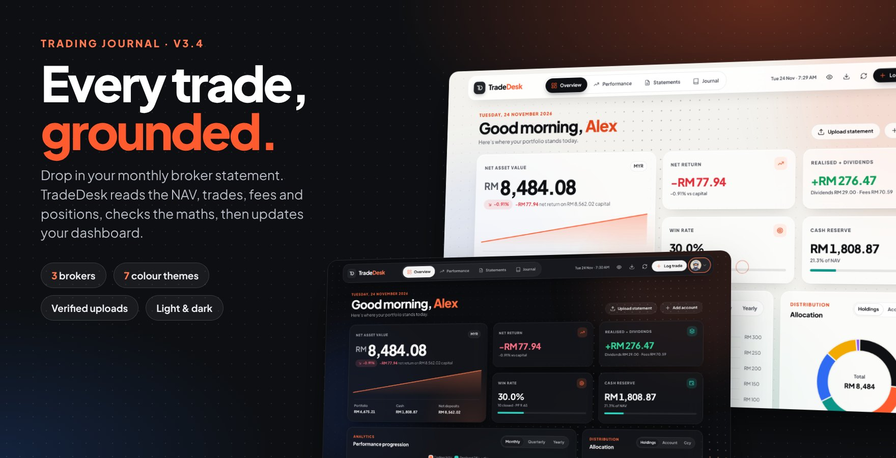
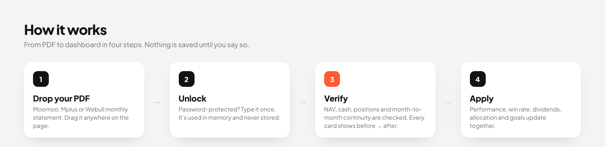
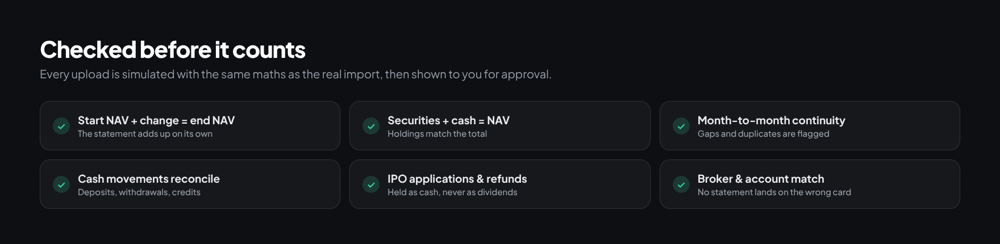
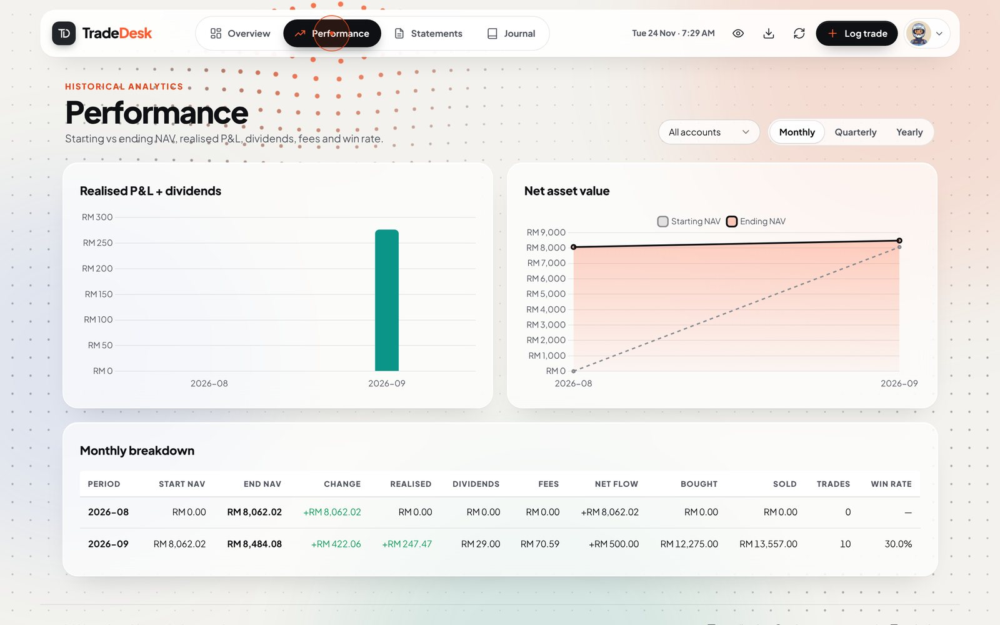
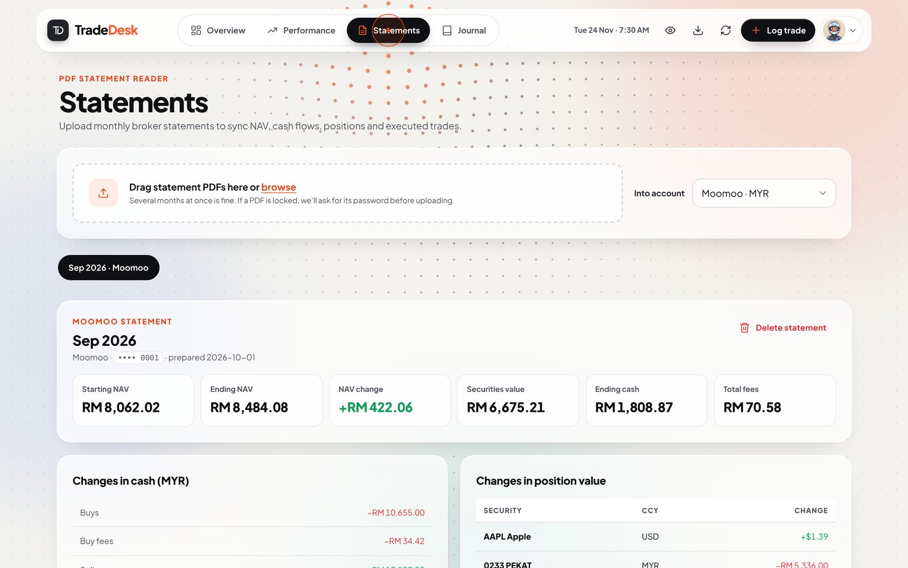
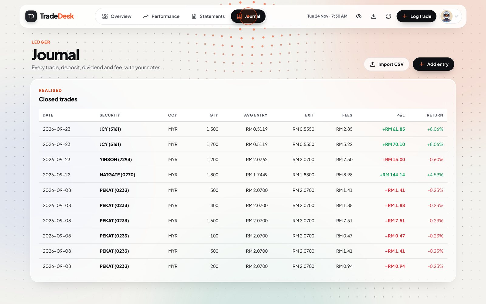
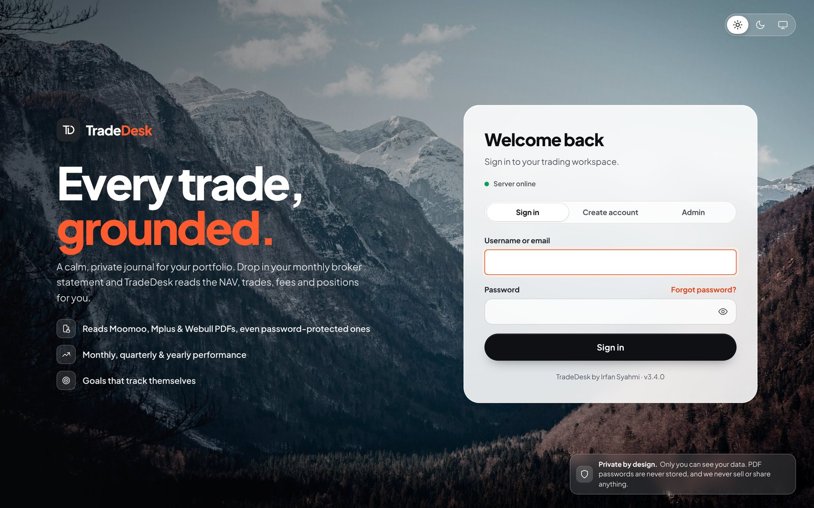
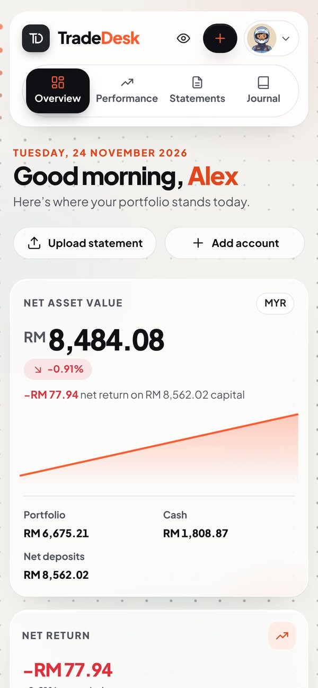
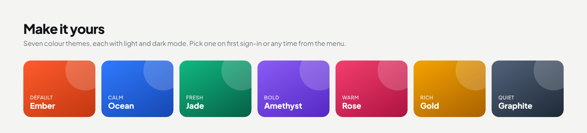

<p align="center">
  
</p>

<h1 align="center">TradeDesk</h1>

<p align="center">
  <em>Drop in a statement. Get the whole picture. Checked before it counts.</em>
</p>

<p align="center">
  
  
  
  
  
</p>

<p align="center">
  
</p>

<p align="center">
  <strong>One monthly PDF in. NAV, trades, fees, dividends and win rate out.</strong><br>
  <strong>Every upload is verified before it touches your dashboard.</strong><br>
  <sub>Works with password-protected statements. Passwords and PDFs are never stored.</sub>
</p>

<p align="center">
  <a href="https://ifanshmy.github.io/tradedesk/"><strong>Open TradeDesk &rarr;</strong></a>
</p>

---

You know the routine. End of the month, three broker apps, three PDFs, one spreadsheet that never quite adds up. A dividend counted twice. An IPO refund that looks like profit. A month you forgot to log.

TradeDesk reads the statements for you, checks the maths, shows you exactly what will change, and only then updates the dashboard.

## How it works

<p align="center">
  
</p>

1. **Drop your PDF.** Moomoo, Mplus or Webull monthly statements, onto an account card or anywhere on the page.
2. **Unlock.** If the file is password-protected, type the password once. It is used in memory only.
3. **Verify.** TradeDesk runs the import as a dry run and shows every dashboard card before and after, plus the result of each check.
4. **Apply.** Or cancel. Nothing is saved until you choose.

## Checked before it counts

<p align="center">
  
</p>

The preview uses the same code as the real import, so what you approve is what you get. IPO applications are held as cash (not withdrawals) and their refunds are not counted as dividends. Mplus trust and trade transfers are recognised as internal, so they do not inflate deposits.

## Every view you need

<p align="center">
  
</p>

| View | What you get |
|---|---|
| **Overview** | NAV, net return, realised P&L + dividends, win rate, cash reserve, allocation by holding, account or currency, broker cards and goals |
| **Performance** | Monthly, quarterly and yearly NAV, realised P&L, dividends, fees and win rate, per account or combined |
| **Statements** | Each imported month: starting and ending NAV, securities, cash, fees, and every cash and position change |
| **Journal** | Closed trades with P&L and return, plus manual entries and CSV import for anything a statement does not cover |

<table>
  <tr>
    <td width="50%"></td>
    <td width="50%"></td>
  </tr>
</table>

<table>
  <tr>
    <td width="68%"></td>
    <td width="32%"></td>
  </tr>
  <tr>
    <td align="center"><sub>Sign in, create an account, or reset your password by email.</sub></td>
    <td align="center"><sub>Built for phones too.</sub></td>
  </tr>
</table>

## Make it yours

<p align="center">
  
</p>

- **Seven colour themes**, each with light and dark mode. New users pick one before the guided tour.
- **Named avatars**, a welcome screen with your name, and a short tour for first-timers.
- **Hide balances** with one tap: every amount turns into dots.
- **Sound effects** and a **cursor effect**, each with its own switch in the profile menu, and both quiet down for reduced-motion settings.

## Private by design

- Passwords are hashed with bcrypt. Reset links are hashed, single-use and expire in 30 minutes.
- Five wrong passwords lock an account for 15 minutes; one address is also limited across accounts.
- Statement data is encrypted in the database. Names are never stored, and account numbers keep only their last 4 digits.
- Strict security headers and a Content-Security-Policy that only allows the site's own scripts.
- An admin security log of sign-ins, failed attempts, resets and account changes (kept 90 days).
- Clear Terms & Conditions that every new user agrees to, recorded with the version and date.
- Sign-in uses server-side sessions that end on sign-out, password change or deactivation.
- PDF files and PDF passwords are never stored.
- Each user only ever sees their own data, and users can deactivate their own account.
- Traffic is HTTPS end to end; the database provider encrypts storage at rest.

## About this repository

This repository is the published website, served by GitHub Pages at **https://ifanshmy.github.io/tradedesk/**.

| Part | Where |
|---|---|
| Website (this repo) | Plain HTML, CSS and ES modules. No build step. Chart.js and Plus Jakarta Sans are bundled. |
| API and database | A FastAPI server on Render, kept in a separate private repository |

```
index.html          The whole app: sign-in, dashboard, dialogs
config.js           Address of the API (apiBase)
assets/js/          app.js (controller), field.js (background), itext.js (interactive text),
                    sound.js, cursor.js, tour.js, version.js
assets/css/         app.css (design tokens + components), fonts.css
assets/img/         Logo, avatars, broker logos, wallpaper
docs/readme/        Images used in this README
```

To point the site at a different API, edit `apiBase` in `config.js`.

## FAQ

**Which brokers?**
Moomoo, Mplus (Malacca Securities) and Webull monthly statements. Any other broker works through the journal.

**Can I see the numbers before they are saved?**
Yes, every time. That is the whole point.

**Does it give trading advice?**
No. It tells you what happened, not what to do next.

**Why "grounded"?**
Because the numbers should come from your statement, not from memory.

---

<p align="center">
  <sub>TradeDesk by Irfan Syahmi. All rights reserved.</sub>
</p>
